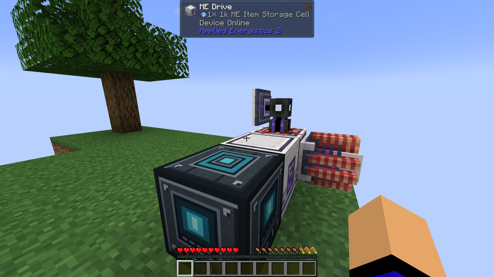
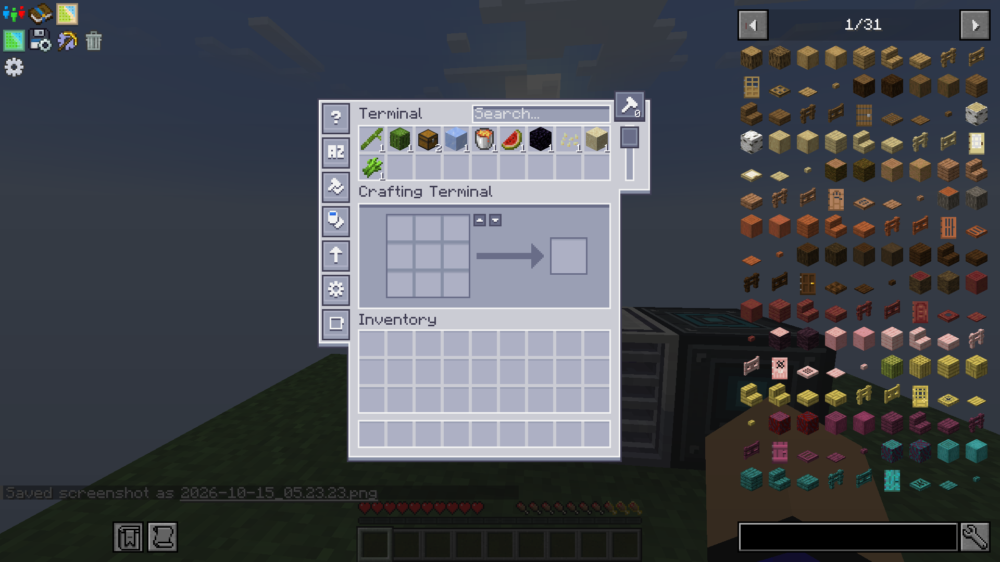

# Startinsel und Startvorrat

## Getesteter Snapshot

Timo bestätigte am 15. Oktober 2026, dass Welt, Spawn und platzierte Maschinen funktionieren. Die Insel wurde leicht vergrößert. Aufgestelltes ME-Netz und Kondensator sind in den beigefügten Referenzbildern sichtbar:

Das ME Drive enthält laut sichtbarer Anzeige **eine 1k ME Item Storage Cell**. Die frühere Empfehlung einer 4k-Zelle wurde nicht in diesen Snapshot übernommen.

## Vorrat im Screenshot

| Gegenstand | Menge |
| --- | ---: |
| Bambus | 1 |
| Kaktus | 1 |
| Kisten als Items | 2 |
| Eis | 1 |
| Lavaeimer | 1 |
| Melonenscheibe | 1 |
| Obsidian | 1 |
| Samen, genaue Sorte ohne Tooltip nicht zuverlässig bestimmt | 1 |
| Sand | 1 |
| Zuckerrohr | 1 |

Die Angaben sind eine visuelle Bestandsaufnahme, keine aus der NBT ausgelesenen Item-IDs. Die zwei Kisten-Items im Netz sind von der entfernten, zuvor aufgestellten Startkiste zu unterscheiden.

## Danach festgelegt

Timo entschied anschließend für Expert und möchte die Gegenstände für einen sofortigen Cobblestone-Generator entfernen. Der Screenshot zeigt daher **nicht den endgültigen Startvorrat**. Eis und Lavaeimer sind für die nächste Revision zu entfernen bzw. die genaue verbleibende Ausstattung festzulegen. Das Entfernen von Obsidian war ein Vorschlag, keine bestätigte Entscheidung.

## Gespeicherte Template-Konfiguration

- Datei: `pack/config/skyblockbuilder/templates.json5`
- Einzige Vorlage: `forever`
- Strukturdatei: `forever.nbt`
- Spawn: `[8, 3, 4]`, relativ zur Struktur; Blickrichtung Osten
- `mainSpawnIsland`: `null`, wodurch die erste und einzige Vorlage verwendet wird

Die Strukturdatei selbst fehlt noch. Nach jeder Revision die Insel in der Bauwelt erneut exportieren und diese echte Datei unter `pack/config/skyblockbuilder/templates/islands/forever.nbt` ersetzen. Änderungen der Startitems müssen an den gespeicherten Maschineninventaren bzw. der Speicherzelle der Vorlage vorgenommen werden; diese Dokumentation ändert das ME-Inventar nicht.
